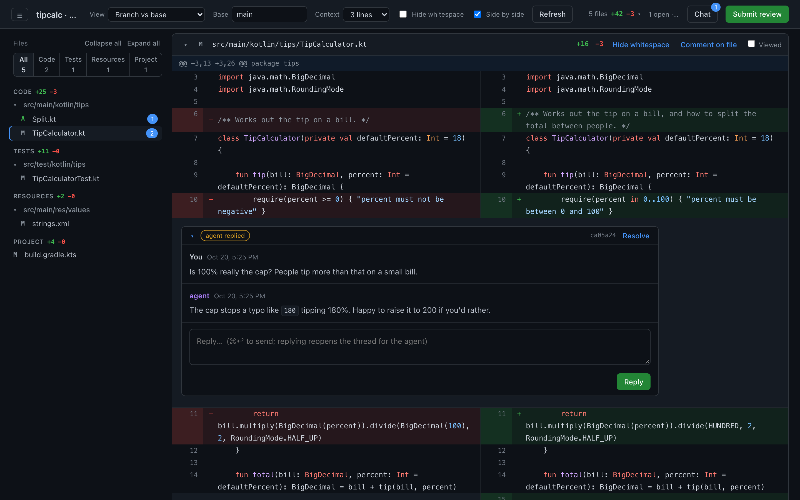
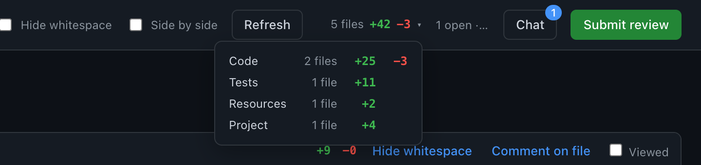
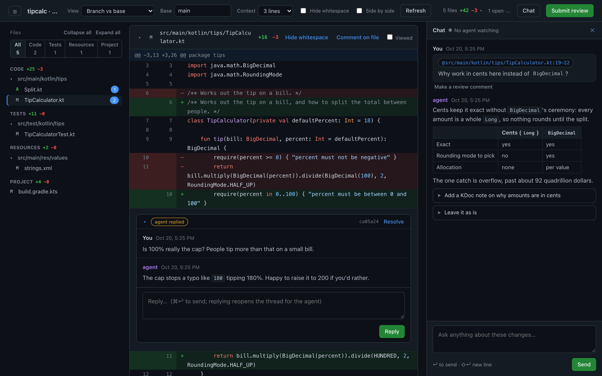

# local-review

Local, GitHub-style review for agent-written changes. You review in a browser and leave line comments, or chat with the agent in a side panel; the agent reads them and replies from the CLI. No push required. Python 3 stdlib only.




## Install

```sh
git clone git@github.com:wmbest2/local-review.git ~/tools/local-review
ln -s ~/tools/local-review/local_review.py ~/.local/bin/local-review      # anywhere on PATH
ln -s ~/tools/local-review/claude/skills/address-review ~/.claude/skills/  # Claude Code skill
```

## Use

```sh
local-review                    # in any repo/worktree: opens the UI (branch vs origin/HEAD)
local-review serve --base main  # choose the base
local-review serve --mode working
```

Then, in Claude Code: `/address-review`. Or just ask Claude to "spin up local-review": the skill starts the server, then watches in the background and picks up each review as you submit it (see [Watching](#watching)).

### Try it on an example
`docs/example/make-example.sh <dir>` builds a small Kotlin repo with a `feature/split-bill` branch that touches code, tests, resources and project files:

```sh
docs/example/make-example.sh /tmp/tipcalc
cd /tmp/tipcalc && local-review serve --base main
```

The screenshots above are that repo, with a submitted review and agent replies seeded. `node docs/screenshots.mjs` regenerates them (headless Chrome, no packages).

### Views
- **Branch vs base**: merge-base(base, HEAD) → working tree. The final result, including uncommitted and untracked files.
- **Uncommitted changes**: HEAD → working tree.
- **Since last review**: snapshot taken when you last clicked Submit → working tree. Use this to check what the agent changed.
- **Stack**: one branch of a stacked-PR series against the branch below it, matching what its PR will show. Appears when a `stack.conf` is at the repo root, and is the default when that stack includes the checked-out branch.

### Stacks
`stack.conf` uses the `push-stack` format (the stacked-PR operator tool): `key = value` settings and `tier | branch | title` rows in stack order. Each branch's parent is the row above; the first row's parent is `trunk`.

```
trunk = develop
A | story/PROJ-1-types  | Neutral types
B | story/PROJ-2-wiring | Wire it up behind a flag
```

Pick the branch from the **Branch** menu. The checked-out branch is reviewed with its working tree (uncommitted edits included); the others are reviewed as committed. Comments remember their branch, anchor to that branch's code, and only show while that branch is selected. `local-review list` prefixes them with `[branch]`, and `list --branch <b>` filters to one. Use `serve --stack FILE` for a config elsewhere.

**Side by side** (header, or `s`) shows the old file on the left and the new on the right instead of one column; changed lines pair up row by row. Comments work the same in both layouts: the **+** on each half comments on that side. The file list is resizable: drag its right edge, double-click it to reset. Both are remembered across repos.

**Hide whitespace** (header) diffs with `git diff -w`, so re-indents don't bury the real change; each file's header also has its own **Hide/Show whitespace** button that overrides it for that file. Line numbers don't change, so comments stay anchored.

### Code, tests, resources and project files
Files are split by kind: **Code**, then **Tests**, **Resources** and **Project**, each under its own heading with its own totals in the sidebar (hover or focus the header totals for the same split). The sidebar's filter (**All / Code / Tests / Resources / Project**, showing only the kinds the view has) narrows both the tree and the diff. `local-review list` marks comments on those files with `· test`, `· resource` or `· project`.



Kinds are guessed from the path:
- **Tests**: test folders (`test/`, `tests/`, `__tests__/`, `spec/`, and Gradle/Android/KMP source sets such as `src/test`, `src/androidTest`, `src/androidUnitTest`, `src/commonTest`, `src/testProdDebug`, Xcode `AppTests/` and `AppUITests/`) or test file names (`FooTest.kt`, `FooTests.swift`, `test_foo.py`, `foo_test.go`, `foo.spec.ts`, ...). A test's fixtures and resources count as tests.
- **Project**: how the code is built, configured and shipped.
  - Kotlin/Android: Gradle scripts and `gradle/`, `build-logic/`, version catalogs, `AndroidManifest.xml`, ProGuard rules, `local.properties`, `google-services.json`, lint baselines, baseline profiles.
  - Python: `pyproject.toml`, `setup.*`, requirements and lockfiles, tool configs (`ruff.toml`, `mypy.ini`, `pytest.ini`, `.flake8`, `.pre-commit-config.yaml`, `noxfile.py`, `MANIFEST.in`).
  - Swift/iOS: Xcode projects and schemes, `.xcconfig`, entitlements, `Info.plist`, `GoogleService-Info.plist`, privacy manifests, `Package.swift`/`.resolved`, CocoaPods, fastlane, Xcode Cloud `ci_scripts/`.
  - Everywhere: CI config (`.github/`, ...), `scripts/`, `.gitignore`, `.editorconfig` and linter configs.
- **Resources**: folders named `res/`, `resources/`, `assets/`, `static/`, `templates/`, `data/`, `fonts/`, `images/`, `sounds/`, `locale(s)/`, `i18n/`, `Preview Content/`, asset catalogs and `.lproj` folders (any case), plus images, fonts, audio, `.strings`/`.xcstrings`, storyboards, XIBs and other plists anywhere. Source files in a resource folder (`data/Repository.kt`, `templates/__init__.py`) stay code.

Override per repo with git config. Each value is one or more globs, matched against the whole path, or against the file name when the glob has no `/`. Overrides win, in this order: `code`, `notTests`, `tests`, `project`, `resources` (`notTests` only stops a file being a test; it's then guessed as one of the others):

```sh
git config --add local-review.tests '*PreviewData.kt'
git config --add local-review.notTests 'app/src/testing/RealThing.kt'
git config --add local-review.project 'scripts/*'
git config --add local-review.resources '*.json'
git config --add local-review.code 'app/src/main/res/raw/rules.js'
```

### Review flow
1. Hover a line and click **+** to write a comment. Comments stay **drafts** (invisible to the agent) until you click **Submit review**. For anything general, use the [chat](#chat) instead.
2. The agent runs `local-review list`, makes changes, and runs `local-review reply <id> [--addressed] -m "..."`.
3. The UI polls, so replies show up live. Replying yourself reopens the thread. Only you **Resolve**.

Statuses: `draft` → `open` → `replied` (agent answered) / `addressed` (agent changed code) → `resolved`.

### Chat
**Chat** (header, or `c`) opens a panel on the right for talking to the agent about the changes. It replaces general (file-less) review comments: messages go to the agent as soon as you send them, with no draft or Submit step, and nothing needs resolving. ↩ sends, ⇧↩ adds a line.



- **About specific lines:** start a comment on a line or range as usual and choose **Ask in chat**. The message carries an `@file:lines` reference, anchored like a comment, so it follows the code as it moves. Click the reference to jump to those lines.
- **Follow-ups:** the agent can offer suggested replies; click one to send it.
- **Make a review comment:** turns a chat message about lines into a draft comment on them, when it's something to track and resolve.
- **Is anyone listening?** The panel shows **Agent watching** while an agent runs `local-review watch`, **Agent working** once it has picked up your message, and **No agent watching** otherwise (messages are kept either way).

The page checks for changes every second (a cheap stat of the state file), so answers appear on their own. How fast they arrive depends on the agent: it answers when its watcher wakes it and it finishes a turn.

Agent side:

```sh
local-review chat                                    # the conversation; unanswered messages are marked
local-review chat --working                          # show the reviewer you're on it (watch does this for you)
local-review chat -m "..." --suggest "Do X" --suggest "Leave it"   # answer, with follow-ups
local-review chat -m - < answer.md                   # a longer answer from stdin
```

Markdown renders in chat and comments: code blocks (highlighted), tables, lists, quotes, links.

### Anchoring
Each comment stores its line's text plus 3 lines of context either side. When the file changes, the comment follows its line to the new position. If the line itself changed, the comment is marked **outdated** and shows its original context.

## Storage
- `<git-dir>/local-review/state.json`: comments, reviews and the chat; per worktree, never committed.
- `<git-dir>/local-review/watch.heartbeat`: touched every second by a running `watch`.
- `refs/local-review/<review-id>`: the working-tree snapshot for each submitted review, used by "Since last review". Snapshots are built from a throwaway index, so your real index and stash are never touched.

## Cleanup
Snapshots from every review are kept for the whole session. When the work is finished (usually the agent does this when you say so):

```sh
local-review clean            # archive resolved threads to archive.json; keep only the latest snapshot
local-review clean --dry-run  # show what would be removed
local-review clean --all      # discard this worktree's whole review (refuses with draft/open comments unless --force)
```

Snapshots that no worktree refers to anymore (e.g. the worktree was deleted) are pruned automatically each time `local-review` starts, once they're over an hour old. `clean` prunes them too. `state.json` and `archive.json` live in the worktree's git dir, so `git worktree remove` deletes them.

## Watching
`local-review watch` prints one line each time a review is submitted, you reply in a thread, or you send a chat message (replies and chat post immediately, without Submit). While it runs it keeps a heartbeat file in the state directory, which is how the chat panel knows an agent is watching; when it reports a chat message it marks the chat as being worked on. `--once` exits after the first event. An agent runs `watch --once` in the background, addresses the review when it exits, then starts it again. The `address-review` skill does this by default whenever it has started a review server, so you don't have to ask.

## Hook (optional)
`local-review status --hook` prints a one-line reminder only when comments are open or chat messages are unanswered, and prints nothing outside a git repo. It's suitable for a Claude Code `UserPromptSubmit` hook.

## Syntax highlighting
Uses highlight.js 11.12.0 (BSD-3-Clause), vendored in `vendor/` and served locally, so it works offline. Each hunk is highlighted as one block, so multi-line comments and strings render correctly. A hunk that starts partway through a block comment can be mis-highlighted; set **Context** to "Full file" to fix that.

## Tests
`python3 test_local_review.py && node test_highlight.js`
