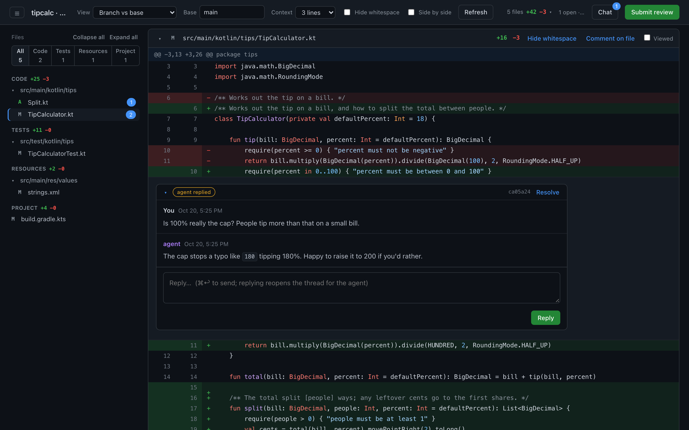

# local-review

Local, GitHub-style review for agent-written changes. You review in a browser and leave line comments; the agent reads them and replies from the CLI. No push required. Python 3 stdlib only.



## Install

```sh
git clone git@github.com:wmbest2/local-review.git ~/tools/local-review
ln -s ~/tools/local-review/local_review.py ~/.local/bin/local-review      # anywhere on PATH
ln -s ~/tools/local-review/claude/skills/address-review ~/.claude/skills/  # Claude Code skill
```

## Use

```sh
local-review                    # in any repo/worktree: opens the UI (branch vs origin/HEAD)
local-review serve --base main  # choose the base
local-review serve --mode working
```

Then, in Claude Code: `/address-review`.

### Views
- **Branch vs base**: merge-base(base, HEAD) → working tree. The final result, including uncommitted and untracked files.
- **Uncommitted changes**: HEAD → working tree.
- **Since last review**: snapshot taken when you last clicked Submit → working tree. Use this to check what the agent changed.
- **Stack**: one branch of a stacked-PR series against the branch below it, matching what its PR will show. Appears when a `stack.conf` is at the repo root, and is the default when that stack includes the checked-out branch.

### Stacks
`stack.conf` uses the `push-stack` format (the stacked-PR operator tool): `key = value` settings and `tier | branch | title` rows in stack order. Each branch's parent is the row above; the first row's parent is `trunk`.

```
trunk = develop
A | story/PROJ-1-types  | Neutral types
B | story/PROJ-2-wiring | Wire it up behind a flag
```

Pick the branch from the **Branch** menu. The checked-out branch is reviewed with its working tree (uncommitted edits included); the others are reviewed as committed. Comments remember their branch, anchor to that branch's code, and only show while that branch is selected. `local-review list` prefixes them with `[branch]`, and `list --branch <b>` filters to one. Use `serve --stack FILE` for a config elsewhere.

### Review flow
1. Hover a line and click **+** to write a comment. Comments stay **drafts** (invisible to the agent) until you click **Submit review**. You can include an overall summary.
2. The agent runs `local-review list`, makes changes, and runs `local-review reply <id> [--addressed] -m "..."`.
3. The UI polls, so replies show up live. Replying yourself reopens the thread. Only you **Resolve**.

Statuses: `draft` → `open` → `replied` (agent answered) / `addressed` (agent changed code) → `resolved`.

### Anchoring
Each comment stores its line's text plus 3 lines of context either side. When the file changes, the comment follows its line to the new position. If the line itself changed, the comment is marked **outdated** and shows its original context.

## Storage
- `<git-dir>/local-review/state.json`: per worktree, never committed.
- `refs/local-review/<review-id>`: the working-tree snapshot for each submitted review, used by "Since last review". Snapshots are built from a throwaway index, so your real index and stash are never touched.

## Cleanup
Snapshots from every review are kept for the whole session. When the work is finished (usually the agent does this when you say so):

```sh
local-review clean            # archive resolved threads to archive.json; keep only the latest snapshot
local-review clean --dry-run  # show what would be removed
local-review clean --all      # discard this worktree's whole review (refuses with draft/open comments unless --force)
```

Snapshots that no worktree refers to anymore (e.g. the worktree was deleted) are pruned automatically each time `local-review` starts, once they're over an hour old. `clean` prunes them too. `state.json` and `archive.json` live in the worktree's git dir, so `git worktree remove` deletes them.

## Watching
`local-review watch` prints one line each time a review is submitted. `--once` exits after the first submission. An agent can run `watch --once` in the background, address the review when it exits, then start it again.

## Hook (optional)
`local-review status --hook` prints a one-line reminder only when comments are open, and prints nothing outside a git repo. It's suitable for a Claude Code `UserPromptSubmit` hook.

## Syntax highlighting
Uses highlight.js 11.12.0 (BSD-3-Clause), vendored in `vendor/` and served locally, so it works offline. Each hunk is highlighted as one block, so multi-line comments and strings render correctly. A hunk that starts partway through a block comment can be mis-highlighted; set **Context** to "Full file" to fix that.

## Tests
`python3 test_local_review.py && node test_highlight.js`
